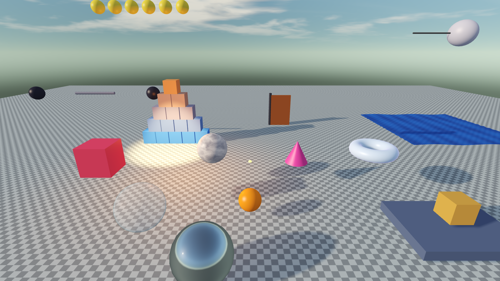
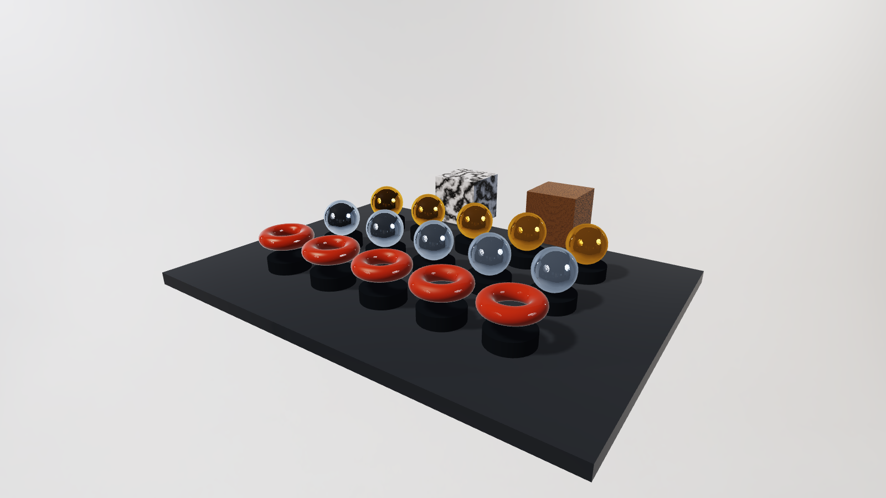

<div align="center">


# Kvas Engine

**Игровой 3D-движок на Rust с редактором в стиле Unity**

ECS · wgpu · Rapier · нодовые материалы · скрипты на Rust с горячей перезагрузкой

[Документация](https://nopass0.github.io/kvas/) ·
[Быстрый старт](#быстрый-старт) ·
[Скрипты](https://nopass0.github.io/kvas/scripting/) ·
[Ноды](https://nopass0.github.io/kvas/nodes/) ·
[Rust API](https://nopass0.github.io/kvas/api/kvas_engine/index.html)



<sub>Кадр демо-проекта <code>games/demo</code>, снятый без окна тем же рендерером, что работает в редакторе и в игре.</sub>

</div>

## Возможности

| | |
|---|---|
| **Редактор** | Иерархия, Инспектор, гизмо, браузер проекта с 3D-превью, Sculpt и UV, texture paint, анимация, звук, GUI, отмена/повтор, русский и английский интерфейс |
| **Нодовый редактор** | 190 нод: шумы с превью, Color Ramp, карты нормалей и высот, свет, углы, стороны, свечение, режимы наложения. Материалы `.kmat`, шейдеры объектов `.kshader`, эффекты камеры `.kfx` |
| **Скрипты** | Rust, горячая перезагрузка, поля в Инспекторе, помощники `look_at`, `move_towards`, `Rng`, `lerp`, `damp`, сообщения между скриптами, таймеры, твины |
| **Рендер** | PBR, тени, HDRI-окружение, процедурное небо и облака, вода, трава, дым, частицы, постобработка, собственный апскейлер в стиле FSR |
| **Физика** | Rapier: тела, коллайдеры, соединения, лучи, CCD, слои, триггеры |
| **Сборка** | Одна папка: `game.exe` + `game.pak` + библиотека скриптов |

## Быстрый старт

Нужен [Rust](https://rustup.rs) и видеокарта с Vulkan или DirectX 12 (проверено на Windows).

```bash
cargo run -p kvas_editor                      # менеджер проектов: недавние, открыть, создать 3D / 2D
cargo run -p kvas_editor -- games/demo        # открыть демо-проект
cargo run -p kvas_editor -- games/demo --play # открыть и сразу нажать Play
cargo build -p kvas_player                    # один раз: редактор копирует его в собранную игру
```

Добавьте `--release`, когда нужна скорость. Скрипты редактор собирает тем же профилем, которым собран сам.
Собрать игру без окна: `cargo run -p kvas_editor -- --build games/demo` (результат в `<проект>/build/`).

| Действие | Ввод |
|---|---|
| Летать камерой | зажать ПКМ, затем W A S D Q E (Shift - быстрее) |
| Панорама / зум / вращение | СКМ / колесо / Alt + ЛКМ |
| Показать выбранное | F |
| Двигать / Вращать / Масштабировать | W / E / R (Ctrl при перетаскивании - привязка) |
| Play / Stop | Ctrl+P (изменения во время игры отбрасываются) |
| Сохранить, Отменить, Повторить, Дублировать, Удалить | Ctrl+S, Ctrl+Z, Ctrl+Y, Ctrl+D, Del |

## Скрипт за минуту

```rust
use kvas_engine::prelude::*;

#[derive(Default)]
pub struct Chaser { speed: f32, stop_distance: f32 }

impl Script for Chaser {
    fn update(&mut self, ctx: &mut Ctx) {
        let Some(player) = ctx.find("Player") else { return };
        let Some(target) = ctx.position_of(player) else { return };
        ctx.look_at_flat(target);
        if ctx.distance_to(player).is_some_and(|d| d > self.stop_distance) {
            ctx.move_towards(target, self.speed);
        }
    }
    fn fields(&mut self) -> Vec<Field<'_>> {       // видно в Инспекторе, сохраняется в сцене
        vec![Field::f32("speed", &mut self.speed), Field::f32("stop_distance", &mut self.stop_distance)]
    }
}
register_scripts!(Chaser);
```

Сохраните файл - редактор пересоберёт библиотеку и перезагрузит скрипты, не закрывая сцену.
Больше примеров: [рецепты](https://nopass0.github.io/kvas/scripting/cookbook) (код проверяется тестами), [шпаргалка по `Ctx`](https://nopass0.github.io/kvas/scripting/).

## Нодовые материалы

Двойной клик по `.kmat` открывает редактор нод: категории с описаниями в меню добавления (Shift+A),
превью прямо в нодах, Color Ramp с градиентом, карты нормалей и высот, свет и углы поверхности,
свечение, шумы (фрактальный, Перлин, Вороной, трещины, облака), режимы наложения как в Photoshop.
См. [как работать с нодами](https://nopass0.github.io/kvas/nodes/) и [справочник всех нод](https://nopass0.github.io/kvas/nodes/reference).



## Документация

Сайт: **https://nopass0.github.io/kvas/** (VitePress + rustdoc). Источники лежат в [`docs/`](docs).

| Раздел | Файл |
|---|---|
| Большое руководство с примерами (шейдеры, камера, частицы, звук, сборка) | [docs/GUIDE.md](docs/GUIDE.md) |
| Рабочие сценарии редактора | [docs/EDITOR_WORKFLOWS.md](docs/EDITOR_WORKFLOWS.md) |
| Rust API: ECS, физика, иерархия, время, сообщения | [docs/ENGINE_API.md](docs/ENGINE_API.md) |
| NVIDIA, DLSS, генерация кадров: что работает, а что нет | [docs/NVIDIA.md](docs/NVIDIA.md) |
| Планы и известные проблемы | [ROADMAP.md](ROADMAP.md) |

Локально:

```bash
cd docs && npm install && npm run dev                       # сайт на http://localhost:5173/kvas/
cargo doc -p kvas_ecs -p kvas_engine -p kvas_render --no-deps --open
./tools/verify.ps1                                          # проверка, тесты, doctest, строгий rustdoc
./tools/verify.ps1 -Gpu                                     # плюс GPU-тесты
```

Сайт публикуется GitHub Actions ([`.github/workflows/docs.yml`](.github/workflows/docs.yml)) при каждом пуше в `main`.
Один раз включите: **Settings → Pages → Source: GitHub Actions**.

## Устройство репозитория

```
crates/kvas_ecs      ECS на разреженных множествах, без зависимостей
crates/kvas_engine   компоненты, сцена (JSON), иерархия, ассеты (+ .pak), меши, физика, скрипты, Runtime, ноды
crates/kvas_render   wgpu-рендерер, WGSL-прелюдия и библиотеки, отладочные линии, склейка с egui
crates/kvas_editor   редактор (панели в отдельных файлах)
crates/kvas_player   запускает собранную игру или папку проекта
crates/kvas_audio    звук
games/demo           демо-проект: сцена, шейдеры, материалы, модели, скрипты
docs/                сайт документации (VitePress)
third_party/         egui_dock под egui 0.37; SDK NVIDIA (локально, вне Git)
```

Принципы (DRY / KISS):

- **Одна рефлексия.** Компонент или скрипт перечисляет поля как `Field` - Инспектор, сохранение сцены и отмена используют тот же список.
- **Один путь к ассетам.** Всё грузится через `Assets` (папка в редакторе, `.pak` в игре).
- **Один игровой цикл.** `Runtime` работает и в Play-режиме редактора, и в проигрывателе.
- **Один рендерер.** Сцена рисуется в текстуру и показывается в egui, в редакторе и в игре.
- Play-режим запускает **копию** сцены, поэтому Stop возвращает всё как было.

## Что реально работает с апскейлом и кадрами

- Собственный пространственный апскейлер в стиле FSR (это **не** официальный AMD FSR SDK).
- Экспериментальная интерполяция кадров ×2 на optical flow.
- Выбор DLSS и Frame Generation в настройках пока подставляет собственный апскейлер: интеграция Streamline требует нативного бэкенда
  (подробности и причины - в [docs/NVIDIA.md](docs/NVIDIA.md)).

## Известные ограничения

- Освещение: одно солнце с картой теней, до 8 точечных и прожекторных ламп без теней, HDRI и процедурное небо. Нет трассировки лучей, преломления и отражений в экранном пространстве.
- glTF: статические меши с запечёнными трансформациями; скиннинг и скелетная анимация не поддерживаются.
- Скрипты не могут определять новые типы компонентов (только встроенные и поля скрипта).
- Проверено на Windows с Rust 1.99; другие платформы не тестировались.

Полный список планов и проблем - в [ROADMAP.md](ROADMAP.md). Лицензия - в [LICENSE](LICENSE).
